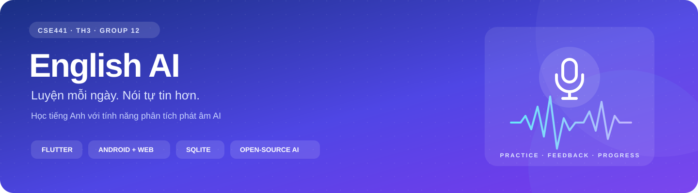
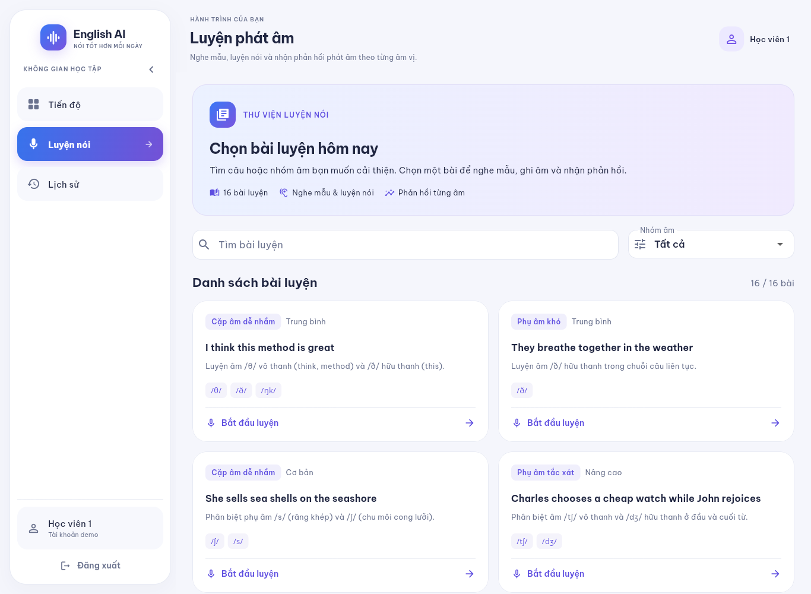
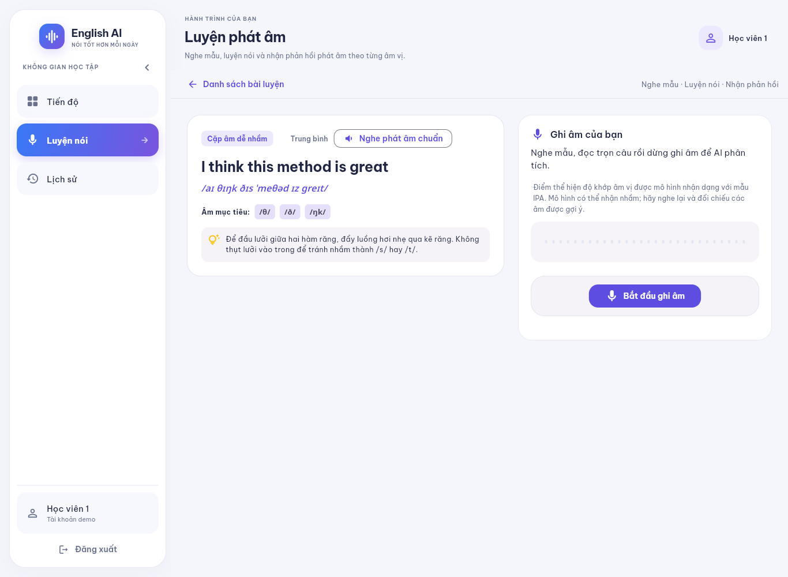
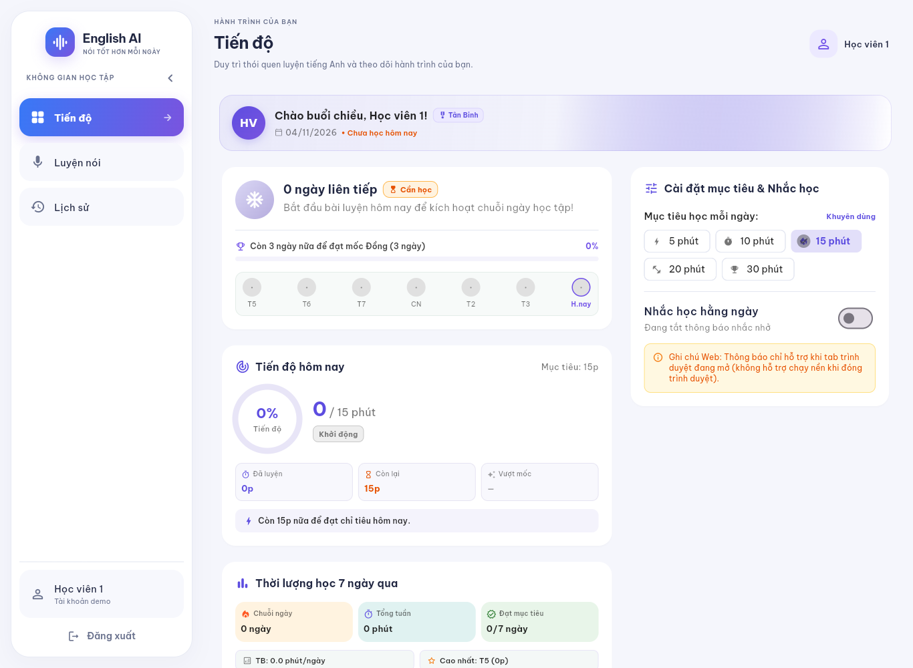
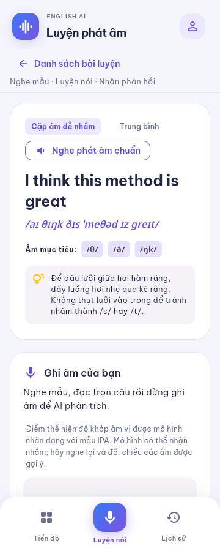
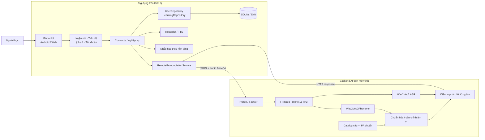
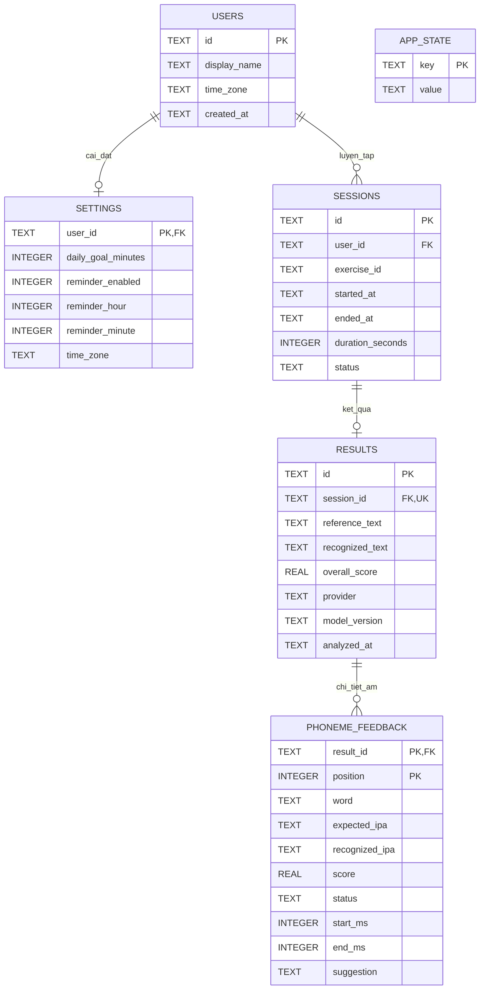
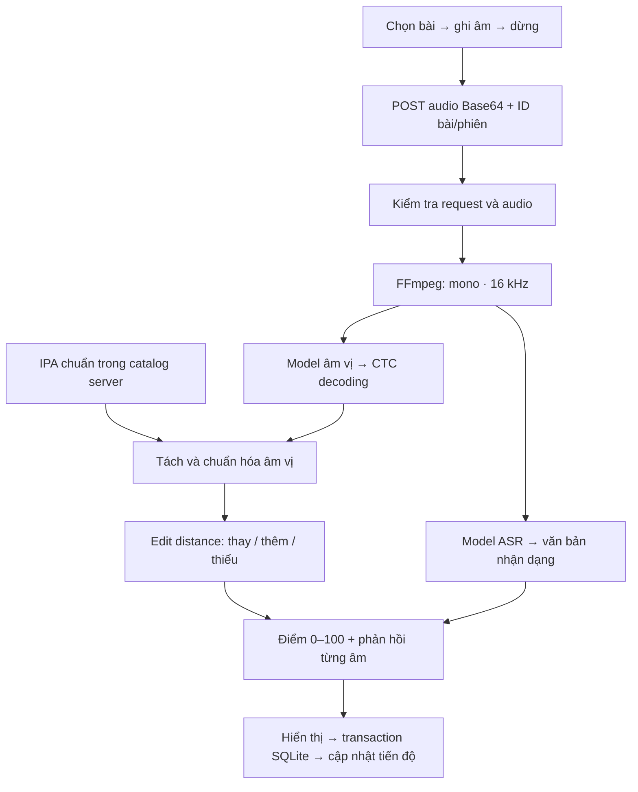

<div align="center">



# TH3 · Xây dựng ứng dụng học tiếng Anh với tính năng phân tích phát âm AI

**CSE441 · Lập trình ứng dụng di động · Nhóm 12 · 65KTPM**

Flutter / Dart · Android & Web · SQLite / Drift · Python / FastAPI · Wav2Vec2

[Giới thiệu](#1-giới-thiệu-đề-tài) · [Thành viên](#2-nhóm-thực-hiện-và-phân-công) · [Kiến trúc](#6-kiến-trúc-thiết-kế) · [Cơ sở dữ liệu](#7-thiết-kế-cơ-sở-dữ-liệu) · [AI & API](#8-ai-so-sánh-âm-vị-lấy-ở-đâu-và-hoạt-động-thế-nào) · [Chạy ứng dụng](#10-cài-đặt-và-chạy-ứng-dụng)

</div>

## 1. Giới thiệu đề tài

**English AI** hỗ trợ người học duy trì thói quen luyện tiếng Anh và nhận phản hồi phát âm ngay sau khi ghi âm. Ứng dụng kết hợp hai nhóm chức năng: **kỷ luật học tập** và **phân tích phát âm bằng AI**.

| Vấn đề cần giải quyết | Giải pháp trong ứng dụng |
|---|---|
| Khó duy trì luyện tập đều đặn | Mục tiêu hằng ngày, nhắc học, chuỗi ngày luyện liên tiếp — streak |
| Khó biết mình phát âm sai ở đâu | Nhận dạng âm vị từ audio, đối chiếu IPA chuẩn và đánh dấu khác biệt |
| Có điểm nhưng chưa biết luyện tiếp thế nào | Hướng dẫn khẩu hình, đề xuất bài chứa đúng âm cần cải thiện |
| Không theo dõi được quá trình học | Lưu lịch sử, thời lượng, điểm và phản hồi theo từng tài khoản |

**Phạm vi:** Android và web; chọn tài khoản demo có sẵn, có đăng xuất; dữ liệu SQLite trên từng thiết bị, không đồng bộ giữa các máy. Máy chủ AI chạy riêng trên máy tính. Đây là phương án triển khai đã thống nhất của nhóm.

## 2. Nhóm thực hiện và phân công

**Nhóm 12 · 4 thành viên**<br>
**Nhóm trưởng:** 2351170625 · Nguyễn Văn Trường

| MSSV | Họ và tên | Vai trò | Công việc phụ trách | Trạng thái |
|---|---|---|---|---|
| **2351170625** | **Nguyễn Văn Trường** | Nhóm trưởng | Phân tích yêu cầu; hợp đồng dữ liệu; khung app, theme/điều hướng; tích hợp module; hoàn thiện backend AI, bản build và báo cáo | ✅ Đã hoàn thành |
| **2251172386** | **Vũ Tuấn Khanh** | Thành viên | Người dùng/repository; thiết kế và lưu trữ dữ liệu; lịch sử, chi tiết kết quả; chuyển đổi dữ liệu và kiểm tra tính nhất quán | ✅ Đã hoàn thành |
| **2351170580** | **Vũ Hải Đăng** | Thành viên | Catalog 16 bài; màn luyện nói; thu âm, nhận dạng, phát mẫu; phản hồi âm vị, điểm/gợi ý; tích hợp hợp đồng API | ✅ Đã hoàn thành |
| **2351170615** | **Lý Đình Sơn** | Thành viên | Mục tiêu; streak; thống kê thời lượng; biểu đồ tiến độ; cài đặt và thông báo nhắc học hằng ngày | ✅ Đã hoàn thành |

Các module của thành viên được kế thừa khi tích hợp. Các nâng cấp dùng chung như SQLite/Drift, tài khoản demo, giao diện thống nhất và backend model được bổ sung trên hợp đồng/module đã có. [Bảng đối chiếu](docs/doi-chieu-th3.md) phân biệt phần kế thừa và phần tích hợp.

## 3. Đối chiếu 7 yêu cầu của bài thực hành

| # | Yêu cầu giảng viên | Phần đáp ứng | Trạng thái |
|---|---|---|---|
| 1 | CSDL người dùng, lịch sử, kết quả | SQLite/Drift, 6 bảng, khóa ngoại/index và transaction | ✅ Đã triển khai |
| 2 | Streak, thời gian, mục tiêu hằng ngày | Phiên hoàn thành, múi giờ, bảng tiến độ và mục tiêu theo tài khoản | ✅ Đã triển khai |
| 3 | API nhận dạng giọng nói, thu âm | Recorder Android/web → FastAPI → Wav2Vec2 ASR | ✅ Đã triển khai |
| 4 | AI/so sánh âm vị và chấm điểm | Wav2Vec2Phoneme + căn chỉnh chuỗi âm vị bằng edit distance | ✅ Đã triển khai |
| 5 | Điểm, âm sai, đề xuất cải thiện | Phản hồi từng âm, hướng dẫn tiếng Việt, bài luyện phù hợp IPA | ✅ Đã triển khai |
| 6 | Nhắc học và hiển thị tiến độ | Thông báo Android, nhắc khi mở tab web, dashboard | ✅ Đã triển khai |
| 7 | Kiểm thử nhiều người, nhiều giọng | Phần nghiệm thu do nhóm xác nhận | ✅ Đã triển khai |

**Cách đọc trạng thái:** mục 7 ghi theo xác nhận của nhóm; số liệu kỹ thuật bên dưới là kết quả có thể kiểm tra từ công cụ/log. Biểu mẫu được giữ nguyên, không điền điểm hoặc tỷ lệ chính xác thay cho dữ liệu đo. Phạm vi kiểm tra Android được ghi riêng trong [biên bản kỹ thuật](docs/kiem-thu-nghien-thu.md).

## 4. Giao diện và trải nghiệm sử dụng

Nền sáng, thẻ trắng, điểm nhấn gradient xanh–tím và font **Be Vietnam Pro** đóng gói trong ứng dụng. Kết quả có chữ và biểu tượng đi kèm màu sắc để dễ nhận biết.

| Danh sách bài luyện · Desktop | Nội dung bài luyện · Desktop |
|:---:|:---:|
|  |  |
| **Tiến độ học tập · Desktop** | **Luyện nói · Mobile** |
|  |  |

- **Desktop:** sidebar có logo/tên app, thu gọn được; mục đang chọn nhấn bằng gradient.
- **Mobile:** thanh điều hướng dưới gọn, nút Luyện nói ở giữa; mở tài khoản qua avatar.
- **Luyện nói:** danh sách → tìm kiếm/lọc → chọn bài → nội dung, IPA và ghi âm. Nút **Danh sách bài luyện** quay lại và giữ bộ lọc.
- **Dữ liệu:** đổi tài khoản không lẫn lịch sử/mục tiêu; đăng xuất giữ dữ liệu để học tiếp.

## 5. Công nghệ sử dụng

| Lớp | Công nghệ | Vai trò |
|---|---|---|
| Ứng dụng | Flutter, Dart, Material 3 | Android/web, giao diện responsive |
| Dữ liệu | SQLite, Drift, `drift_flutter` | Bảng, giao dịch, lưu cục bộ; web dùng SQLite WASM |
| Migration | SharedPreferences | Import JSON cũ một lần sang SQLite |
| Thu âm | `record`; MediaRecorder | Audio thật trên Android/web, quản lý quyền và vòng đời |
| Phát mẫu | `flutter_tts`; Web Speech Synthesis | Đọc câu tiếng Anh; dùng giọng TTS có trên thiết bị/trình duyệt |
| Nhắc học | `flutter_local_notifications`, `timezone` | Lịch hệ điều hành và múi giờ |
| Backend | Python, FastAPI, Uvicorn | HTTP API nhận audio/trả phân tích |
| AI | PyTorch CPU, Hugging Face Transformers | Nạp và chạy hai checkpoint Wav2Vec2 |
| Audio | FFmpeg qua `imageio-ffmpeg`, NumPy | Giải mã, mono 16 kHz, kiểm tra tín hiệu |
| Chấm điểm | CTC decoding, chuẩn hóa IPA, edit distance | Xác định âm khớp/thay/thêm/thiếu |
| Kiểm tra | Flutter Test, Python unittest, Playwright | Logic, widget, API, luồng trình duyệt |

Phiên bản: [pubspec.yaml](pubspec.yaml), [pubspec.lock](pubspec.lock), [requirements.lock.txt](backend/pronunciation/requirements.lock.txt). Dart SDK yêu cầu `^3.13.2`; dùng Flutter đi kèm Dart phù hợp. Không nâng thư viện tùy ý trước khi chạy lại kiểm thử.

## 6. Kiến trúc thiết kế

Tổ chức theo **chức năng**, chia giao diện, nghiệp vụ và truy cập dữ liệu/dịch vụ. Các module giao tiếp qua hợp đồng trong `lib/core/contracts`; `main.dart` khởi tạo repository/dịch vụ thật và truyền vào màn hình.



| Thành phần | Trách nhiệm |
|---|---|
| Presentation | Trạng thái, thao tác, responsive; không trực tiếp thực thi SQL/model |
| Domain / contracts | Model, quy tắc streak, kiểm tra audio, interface repository/dịch vụ |
| Data / services | SQLite, import cũ, HTTP, recorder, TTS, notification adapter |
| Backend AI | Kiểm tra đầu vào, lấy tham chiếu từ catalog server, suy luận và so sánh |
| Tích hợp | Repository phát sự kiện sau ghi; Lịch sử/Tiến độ tải lại đúng tài khoản |

Backend tách khỏi Flutter để điện thoại không phải tải hai model lớn. Audio xử lý trong bộ nhớ backend; bản mặc định không lưu bản ghi trên server. Mỗi tiến trình nhận một yêu cầu phân tích tại một thời điểm để hạn chế RAM.

## 7. Thiết kế cơ sở dữ liệu

**CSDL:** `english_ai` · **Schema:** version 1. Android dùng SQLite native; web dùng SQLite WASM với cơ chế lưu bền vững do Drift chọn theo trình duyệt. [Mở ảnh sơ đồ CSDL](docs/assets/database-diagram-preview.png) nếu trình xem không hỗ trợ Mermaid.



| Bảng | Ý nghĩa và ràng buộc |
|---|---|
| `users` | Tài khoản demo, tên, múi giờ, ngày tạo |
| `settings` | Một cài đặt/người dùng; mục tiêu > 0, giờ 0–23, phút 0–59 |
| `sessions` | Phiên luyện, thời lượng chủ động ≥ 0, trạng thái |
| `results` | Tối đa một kết quả/phiên; điểm 0–100, văn bản và phiên bản model |
| `phoneme_feedback` | Khóa ghép `(result_id, position)`; IPA, điểm/mốc thời gian nullable |
| `app_state` | Trạng thái ứng dụng, dấu import cũ; không chứa mật khẩu |

Bật khóa ngoại khi mở CSDL; index `sessions_user_date(user_id, started_at)` phục vụ lịch sử. `savePractice` ghi phiên/kết quả/âm vị trong **cùng transaction**, lỗi sẽ rollback. Gửi lại cùng ID/dữ liệu không tạo trùng; truy xuất kết quả kiểm tra chủ sở hữu.

Timestamp lưu UTC; hiển thị/tính ngày theo múi giờ tài khoản. Streak dựa trên ngày có phiên hoàn thành, nhiều phiên một ngày chỉ tính một ngày. Không cộng thời gian chờ API vào thời lượng luyện. Catalog là mã nguồn/JSON, không phải bảng SQL; `exercise_id` tham chiếu ID catalog ở tầng ứng dụng. `app_state` là bảng key–value độc lập nên không vẽ quan hệ khóa ngoại tới `users`.

[Schema/migration chi tiết](docs/user_data/sqlite-schema.md) · [Mã nguồn CSDL/repository](lib/features/user_data/data/learning_database.dart).

## 8. AI so sánh âm vị lấy ở đâu và hoạt động thế nào?

### 8.1. Nguồn model

Dùng checkpoint có sẵn của **Meta/Facebook trên Hugging Face**, chạy bằng PyTorch/Transformers trên backend. Không phải API chấm điểm mua từ bên thứ ba; cấu hình hiện tại không cần API key.

| Vai trò | Model / nguồn chính thức | Revision khóa |
|---|---|---|
| **Âm vị từ audio** | [facebook/wav2vec2-lv-60-espeak-cv-ft](https://huggingface.co/facebook/wav2vec2-lv-60-espeak-cv-ft) | `ae45363bf341…` |
| **Văn bản từ audio** | [facebook/wav2vec2-base-960h](https://huggingface.co/facebook/wav2vec2-base-960h) | `22aad52d435e…` |

Cả hai dùng đầu vào 16 kHz, giấy phép Apache 2.0. Model âm vị trả nhãn phiên âm; model ASR trả văn bản. [Tài liệu Wav2Vec2Phoneme](https://huggingface.co/docs/transformers/model_doc/wav2vec2_phoneme); revision đầy đủ trong [models.json](backend/pronunciation/models.json).

[setup_backend.ps1](backend/pronunciation/setup_backend.ps1) tạo môi trường Python, cài thư viện đã khóa và gọi [engine.py](backend/pronunciation/engine.py) để tải/nạp model. Cache ở `backend/pronunciation/.models/`, được bỏ qua bởi Git. Giữ cache để chạy lại mà không tải model mỗi lần. Backend giải mã vocab âm vị trực tiếp, không cần cài eSpeak riêng cho luồng hiện tại. Nhóm tích hợp model và thuật toán so sánh, không tự huấn luyện hai checkpoint này.

### 8.2. Quy trình phân tích



1. Kiểm tra dung lượng/độ dài/tín hiệu; bản ghi quá ngắn, im lặng hoặc hỏng được báo lỗi.
2. Model âm vị nhận nhãn từ **audio thực tế**. CTC gộp nhãn lặp, bỏ nhãn trống.
3. Chuẩn hóa `r/ɹ`, `e/ɛ`, `əʊ/oʊ`; tách IPA và căn chỉnh chuỗi chuẩn/nhận dạng.
4. Phân biệt khớp/thay/thiếu/thêm; trả hướng dẫn và khoảng thời gian CTC quan sát được.
5. ASR độc lập cung cấp câu đã nghe. **Transcript client không được dùng để sinh điểm.**

### 8.3. Công thức điểm và phản hồi

`N`: số âm chuẩn; `M`: số âm nhận dạng; `D`: số thao tác thay/thêm/thiếu tối thiểu, mỗi thao tác chi phí 1:

```text
overallScore = round(100 × max(0, 1 − D / max(N, M)), 1)
```

Ví dụ thuật toán: chuẩn `/θ ɪ ŋ k/`, nhận `/s ɪ ŋ k/` → `D = 1`, `N = M = 4` → **75 điểm**.

| Phản hồi | Hiển thị | Hành động |
|---|---|---|
| Khớp sau chuẩn hóa | Khớp mẫu | Tiếp tục luyện cả câu |
| Thay/thiếu âm | Cần luyện | Hướng dẫn khẩu hình, bài chứa đúng âm trong IPA |
| Thêm âm (`∅` trong dữ liệu) | Âm thừa | Nghe lại phần nhận thêm; không tạo “bài luyện âm ∅” |
| Confidence thấp | Chưa xác định, điểm chi tiết `null` | Thu lại; không mặc định âm sai |

Đề xuất ưu tiên bài chuyên luyện đúng âm, sau đó câu chứa cùng đơn vị IPA. Không khớp bằng chuỗi con: `/ɪ/` khác `/eɪ/`; không ghép cụm âm qua hai từ. Nếu không có bài khác phù hợp, có thể luyện lại bài hiện tại; không chọn bài bất kỳ.

Điểm là **độ khớp chuỗi âm vị do model nhận dạng**, không phải xác suất đúng hoặc điểm chuyên gia/GOP. Model có thể nhận nhầm; chưa chấm trọng âm/ngữ điệu. [Thuật toán chi tiết](docs/pronunciation/api-and-scoring.md) · [Báo cáo model](docs/pronunciation/evaluation.md).

## 9. API lấy ở đâu và sử dụng như thế nào?

**API do backend Python của dự án cung cấp**, mã tại [server.py](backend/pronunciation/server.py). Hugging Face là nơi tải trọng số; khi chấm, Flutter gọi backend trên máy tính, không gửi audio tới Hugging Face.

| Phương thức | Đường dẫn | Mục đích |
|---|---|---|
| `GET` | `/health` | Kiểm tra server và `assessmentReady` |
| `POST` | `/api/pronounce/analyze` | Nhận bản ghi, trả phân tích |
| `GET` | `/docs` | Swagger UI để xem/thử API |
| `GET` | `/openapi.json` | Đặc tả OpenAPI |

Khi backend chạy: [Health](http://127.0.0.1:8080/health) · [Swagger UI](http://127.0.0.1:8080/docs).

<details>
<summary><strong>Xem request, response và ví dụ gọi API bằng Python</strong></summary>

Request `Content-Type: application/json`:

```json
{
  "sessionId": "sess-example-01",
  "exerciseId": "ex-01-dental-fricative-unvoiced",
  "audioBase64": "<Base64 của file audio>",
  "mimeType": "audio/wav"
}
```

Server lấy câu/IPA theo `exerciseId` từ [catalog](assets/pronunciation/exercises.json), không tin tham chiếu client. FFmpeg giải mã audio; body tối đa 12 MB, audio tối đa 8 MB, dài 0,4–60 giây.

Ví dụ chạy từ thư mục gốc khi backend sẵn sàng; thay `my-recording.wav` bằng file của bạn:

```python
import base64
from pathlib import Path
import httpx

response = httpx.post(
    "http://127.0.0.1:8080/api/pronounce/analyze",
    json={
        "sessionId": "sess-example-01",
        "exerciseId": "ex-01-dental-fricative-unvoiced",
        "audioBase64": base64.b64encode(
            Path("my-recording.wav").read_bytes()
        ).decode("ascii"),
        "mimeType": "audio/wav",
    },
    timeout=120,
)
response.raise_for_status()
print(response.json())
```

Response thành công: `id`, `sessionId`, `referenceText`, `recognizedText`, `overallScore`, `phonemes`, `provider`, `modelVersion`, `analyzedAt`; kèm metadata so sánh/thời gian/model. Mỗi phần tử `phonemes` chứa từ, IPA chuẩn/nhận dạng, trạng thái, điểm, gợi ý và mốc thời gian nếu có.

| HTTP | Ý nghĩa |
|---|---|
| `200` | Có kết quả phân tích |
| `400` / `413` | Request/audio sai, bài không tồn tại hoặc quá dung lượng |
| `422` | Không đủ bằng chứng giọng nói |
| `429` | Đang xử lý bản ghi khác |
| `503` | Model chưa sẵn sàng |
| `500` | Lỗi xử lý nội bộ |

Lỗi trả `code`, `message`, không có điểm thay thế. Flutter chờ tối đa 120 giây; mất kết nối thì hướng dẫn mở backend, không chuyển sang chấm mô phỏng.

</details>

## 10. Cài đặt và chạy ứng dụng

### Chuẩn bị

- Windows, Flutter/Dart phù hợp [pubspec.yaml](pubspec.yaml), Python 3.11+ 64-bit, Chrome.
- Android SDK và emulator/điện thoại nếu chạy Android.
- Internet cho lần cài thư viện/model đầu tiên; vài GB trống. Đã chạy CPU trên RAM 16 GB; đây là cấu hình thử, không phải mức tối thiểu đã đo.

### Lần đầu

Mở PowerShell **tại thư mục gốc dự án**:

```powershell
flutter pub get
powershell -ExecutionPolicy Bypass -File backend/pronunciation/setup_backend.ps1
.\run_web.bat
```

`run_web.bat` mở backend nếu chưa chạy, chờ model sẵn sàng rồi mở Flutter/Chrome tại cổng **7357**. Backend được giữ chạy sau khi đóng terminal Flutter để trang còn mở vẫn chấm được. Những lần sau chỉ cần `run_web.bat`.

<details>
<summary><strong>Chạy backend và Flutter riêng</strong></summary>

Terminal 1:

```powershell
.\run_backend.bat
```

Terminal 2, khi log báo `Application startup complete`:

```powershell
Invoke-RestMethod http://127.0.0.1:8080/health
flutter run -d chrome --web-port 7357
```

Health cần `assessmentReady: true`. Chỉ chạy `flutter run` không tự mở backend. Log launcher: `backend/pronunciation/.runtime/backend.stderr.log`.

</details>

### Android

Khởi động backend trên máy tính trước. Emulator mặc định gọi `http://10.0.2.2:8080/api/pronounce/analyze`:

```powershell
flutter devices
flutter run -d <device-id>
```

Điện thoại nối USB, bật USB debugging:

```powershell
adb reverse tcp:8080 tcp:8080
flutter run -d <device-id> --dart-define=PRONUNCIATION_API_URL=http://127.0.0.1:8080/api/pronounce/analyze
```

`127.0.0.1` trên điện thoại là chính điện thoại; `adb reverse` chuyển cổng về máy tính. Địa chỉ khác cấu hình bằng `PRONUNCIATION_API_URL`. Qua mạng dùng HTTPS; bản Android chỉ cho HTTP với localhost/emulator đã khai báo. Backend mặc định bind `127.0.0.1`, không phải dịch vụ công khai.

### Lỗi thường gặp

| Hiện tượng | Cách xử lý |
|---|---|
| `Failed to fetch` / không kết nối được AI | Mở `run_backend.bat`, chờ model, kiểm tra `/health`; giữ backend chạy |
| Điện thoại không gọi được API | Kiểm tra `adb reverse` và địa chỉ; không dùng `10.0.2.2` cho điện thoại thật |
| Không thu được micro | Cấp quyền; web dùng localhost/HTTPS, kiểm tra thiết bị đầu vào |
| `422` / im lặng / thiếu bằng chứng | Đọc đủ câu, nói đủ lớn, giảm tiếng ồn |
| `429` | Chờ bản ghi trước xong rồi thử lại |
| Không thấy lịch sử sau đổi cổng web | Dùng lại cùng origin/cổng, tránh ẩn danh/xóa dữ liệu trình duyệt |
| Đóng tab web không nhận nhắc | Web nhắc khi tab còn mở, không có web push nền |
| Nhắc Android bị trễ | Kiểm tra quyền/pin; lịch dùng chế độ inexact của hệ điều hành |

## 11. Hướng dẫn thao tác

1. **Vào tài khoản:** chọn Học viên 1–4, không tạo hồ sơ trong luồng chính.
2. **Đặt mục tiêu:** mở Tiến độ, chọn phút/ngày; bật nhắc, cấp quyền, chọn giờ.
3. **Chọn bài:** mở Luyện nói, tìm theo câu/IPA/chủ đề hoặc lọc nhóm, bấm bài cần luyện.
4. **Luyện:** xem câu/IPA/hướng dẫn, nghe mẫu, bấm **Bắt đầu ghi âm**; cấp quyền micro.
5. **Phân tích:** bấm **Dừng & Phân tích**; xem điểm, câu nhận dạng và âm đánh dấu.
6. **Cải thiện:** làm theo hướng dẫn từng âm, chọn bài đề xuất hoặc ghi lại; nút **Danh sách bài luyện** quay về catalog.
7. **Theo dõi:** mở Lịch sử xem chi tiết, Tiến độ xem thời lượng/mục tiêu/streak.
8. **Đăng xuất:** mở Tài khoản/avatar → Đăng xuất; chọn lại tài khoản cũ để học tiếp.

Demo không có mật khẩu, chỉ tách dữ liệu trên thiết bị, không thay thế xác thực an toàn. Không đồng bộ dữ liệu giữa web/Android. [Hướng dẫn chi tiết](docs/huong-dan-su-dung.md).

## 12. Kiểm tra chất lượng và build

```powershell
flutter analyze
flutter test
.venv/Scripts/python.exe -m unittest discover -s backend/pronunciation/tests -v
flutter build web --release --no-wasm-dry-run
flutter build apk --release
```

| Kiểm tra | Phạm vi |
|---|---|
| Flutter analyzer/tests | Contracts, CSDL/transaction, tách tài khoản, streak/múi giờ, API client, điều hướng/responsive, gợi ý và âm thừa |
| Backend unittest | Audio hỏng/im lặng, thiếu bằng chứng, âm thay/thêm/thiếu, bảo vệ tham chiếu server |
| Trình duyệt tự động | Danh sách → bài → ghi âm/API → SQLite → mở lại lịch sử, desktop/mobile |
| Nhiều người/giọng | Đạt theo xác nhận nhóm; không dùng số liệu audio tổng hợp thay thế |

**Kết quả ngày 04/11/2026:** analyzer không báo vấn đề, **154 test Flutter** và **15 test backend** đạt; build web/APK thành công, luồng trình duyệt không có lỗi JavaScript. [Biên bản đợt sửa này](docs/kiem-tra-ky-thuat-2026-11-04.md) ghi phạm vi và giới hạn kiểm tra Android; [quy trình tái kiểm tra](docs/kiem-thu-nghien-thu.md) được giữ riêng. Kiểm tra trình duyệt dùng audio tổng hợp để xác minh tích hợp; [verification.json](screenshots/final/verification.json) ghi rõ điều này.

**Đầu ra:** APK `build/app/outputs/flutter-apk/app-release.apk`; web `build/web/`. Server web cần phục vụ `sqlite3.wasm` với MIME `application/wasm`. Flutter web hiện build JavaScript, dùng WASM cho SQLite.

APK/web cần truy cập backend khi chấm. Bàn giao máy mới phải chạy setup backend; không đóng gói `.venv`/model cache vào Git.

## 13. Cấu trúc mã nguồn

```text
lib/
├── app/                         # Theme, shell, điều hướng, tài khoản demo
├── core/contracts/              # Model và interface chung
├── core/learning_time.dart      # UTC, múi giờ, quy tắc ngày
├── features/
│   ├── user_data/               # SQLite, migration, repository, lịch sử
│   ├── discipline/              # Streak, mục tiêu, thống kê, nhắc học
│   └── pronunciation/           # Catalog, luyện nói, recorder, HTTP, feedback
└── main.dart                    # Nối dịch vụ thật
backend/pronunciation/
├── server.py                    # FastAPI
├── engine.py                    # Audio + suy luận hai model
├── phoneme_comparison.py        # Chuẩn hóa, căn chỉnh, điểm
├── models.json                  # ID + revision
└── tests/                       # Kiểm thử backend
assets/pronunciation/            # Catalog đối chiếu client/server
test/                           # Kiểm thử Flutter
tool/                           # Launcher, kiểm tra toàn luồng
docs/                           # Báo cáo, hướng dẫn, biểu mẫu
screenshots/final/               # Minh chứng trình duyệt hiện tại
run_web.bat                     # Backend + web
run_backend.bat                 # Backend riêng
```

Fake service/engine cũ được giữ cho kiểm thử và tương thích module thành viên; đường chạy mặc định dùng SQLite/backend model thật, không trả điểm giả khi API lỗi.

## 14. Giới hạn và hướng phát triển

- Mở rộng phân tích trọng âm/ngữ điệu và căn chỉnh thời gian chính xác hơn.
- Model có thể nhận nhầm; giữ metadata và trạng thái “chưa xác định” để người học đối chiếu.
- Nếu triển khai backend công khai: bổ sung xác thực, HTTPS, hàng đợi, quản lý tài nguyên.
- Phiên bản sau có thể có đăng nhập thật, đồng bộ và thông báo web nền.

## 15. Tài liệu và nguồn tham khảo

| Nội dung | Tài liệu |
|---|---|
| Checklist, phân công, kế thừa/tích hợp | [Đối chiếu TH3](docs/doi-chieu-th3.md) |
| Sử dụng | [Hướng dẫn thao tác](docs/huong-dan-su-dung.md) |
| Backend/model | [Cài và chạy backend](backend/pronunciation/README.md) |
| API/điểm | [API & scoring](docs/pronunciation/api-and-scoring.md) |
| CSDL | [Schema/migration](docs/user_data/sqlite-schema.md) |
| Kiểm tra | [Biên bản kỹ thuật](docs/kiem-thu-nghien-thu.md) |
| Model card | [Âm vị](https://huggingface.co/facebook/wav2vec2-lv-60-espeak-cv-ft) · [ASR](https://huggingface.co/facebook/wav2vec2-base-960h) |
| Thư viện AI | [Transformers Wav2Vec2Phoneme](https://huggingface.co/docs/transformers/model_doc/wav2vec2_phoneme) |

Font Be Vietnam Pro: [OFL](assets/fonts/OFL.txt); font dự phòng/IPA: [Roboto](assets/fonts/Roboto-OFL.txt), [Noto Sans](assets/fonts/NotoSans-OFL.txt). Giấy phép model theo model card từng checkpoint.

<div align="center">

**English AI · Nhóm 12 · TH3 — CSE441**<br>
Luyện tập đều đặn · Phản hồi cụ thể · Theo dõi tiến bộ

</div>
